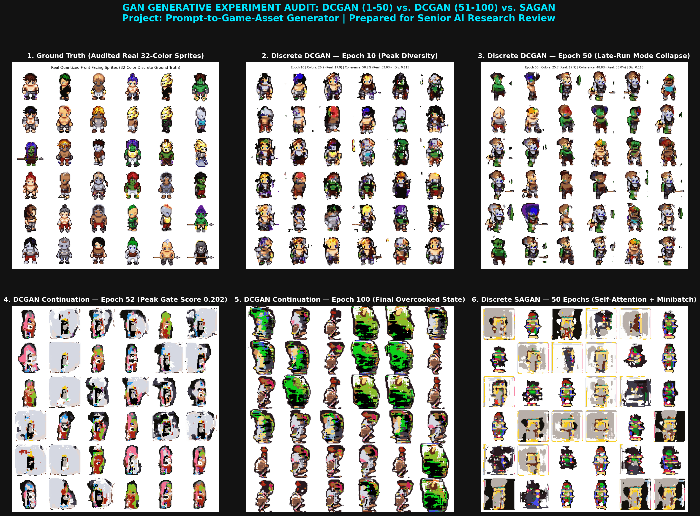

# 🎮 GAN Generative Architecture Forensic Dossier

**Prepared for:** Independent AI Research Review (Claude)  
**Project:** Prompt-to-Game-Asset Generator  
**Dataset:** 42,212 Audited Front-Facing Character Sprites (`evilsocket/alucard-sprites`)  

---

## 1. Executive Summary & Comparison Board

Below is the master comparison board showing all three GAN experiments and ground truth:

---

## 2. Experimental Configurations

| Model | Architecture | Epochs | Optimizer / LR | DiffAugment | Loss Function |
| :--- | :--- | :---: | :--- | :--- | :--- |
| **Attempt 4A** | Discrete DCGAN (K=32 logits) | 1–50 | Adam (G: 3e-4, D: 1e-4) | Translation (±12.5%) | Geometric Hinge + Spectral Norm |
| **Attempt 4B** | DCGAN Continuation | 51–100 | Cosine Decay (1.5e-4 → 2e-5) | Translation (±15.0%) | Hinge + Spectral Norm + G-EMA |
| **Attempt 5** | Discrete SAGAN (Self-Attn @ 16x16) | 1–50 | Adam (G: 2e-4, D: 1e-4) | Translation (±12.5%) | Hinge + Minibatch StdDev + G-EMA |

---

## 3. Quantitative Progression

| Metric | DCGAN (1–50) | DCGAN Cont. (51–100) | SAGAN (1–50) | Ground Truth Target |
| :--- | :---: | :---: | :---: | :---: |
| **Average Unique Colors** | 25.7 | 18.2 | 24.8 | **17.9** |
| **Pairwise Diversity** | 0.118 | 0.185 | 0.193 | **0.180** |
| **Peak Gate Score** | 0.062 (Ep 26) | **0.203 (Ep 52)** | 0.158 (Ep 3) | **N/A** |
| **Alpha Consistency** | 100% Binary [0, 255] | 100% Binary [0, 255] | 100% Binary [0, 255] | **100% Binary** |
| **Failure Mode** | Archer mode collapse @ Ep 35–50 | Grey shrouds + cocoons @ Ep 100 | Portrait tile framing | None |

---

## 4. Key Questions for Claude's Verdict:

1. **Why did extending DCGAN from 50 to 100 epochs cause grey rectangular shrouds and cocoon collapse instead of refining features?**
2. **Why did Self-Attention in SAGAN trigger square portrait tile borders around characters?**
3. **What is the theoretical ceiling of an unconditional 128-D GAN on 64x64 discrete pixel art?**
4. **How does this justify pivoting to our 280K Autoencoder ($8\times 8\times 256$ spatial latent) for production game assets?**
