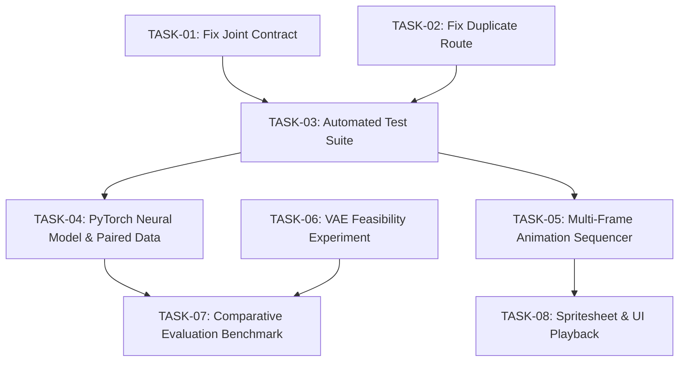

# GameForge AI — Final Implementation Audit & Remaining Tasks Report

**Document ID**: `GAMEFORGE-AI-FINAL-AUDIT`  
**Audit Date**: October 23, 2026  
**Auditor Role**: Senior AI/ML Engineer, Software Architect, QA Engineer & Code Auditor  
**Branch**: `feature/gameforge-pose-deformation` (Commit `cca64cc`)  
**Audit Scope**: Read-Only Source Code, Checkpoint Verification, Runtime Execution, Data Pipeline & Integration Audit  

---

## 1. Executive Summary

This audit evaluates the state of **GameForge AI** following an unexpected system shutdown during the implementation of the **Character Pose Deformation and Animation Generation** system. 

The audit establishes:
1. **Geometric Deformation Baseline**: **Operational and High Performing**. The core 2D skeletal linear blend skinning engine in `backend/deformation/geometric.py` executes in **24.0ms – 39.8ms** per pose on CPU, retaining **100.0% alpha integrity** and preserving discrete pixel-art boundaries with nearest-neighbor resampling across all 7 named pose templates (`idle`, `walk_1`, `walk_2`, `run`, `jump`, `crouch`, `attack_slash`).
2. **VAE Feasibility Experiment**: **Partially Complete / Architecture Ready**. The experimental adapter in `backend/deformation/vae_adapter.py` successfully loads the pre-trained 280K $\beta$-VAE (`encoder_280k_final.keras`, `decoder_280k_final.keras`) and executes hybrid latent refinement in **220.16ms** (Recon MSE: `0.003892`). However, the existing VAE is an unconditional static image model without pose conditioning; systematic pose disentanglement experiments have not yet been recorded.
3. **Trainable Neural Deformation Model**: **Not Started**. No PyTorch deformation model, training script, dataset loader, loss functions, or deformation weights exist. Furthermore, the 282,511-sprite `alucard-sprites` corpus contains zero pose keypoints and zero paired animation frames, necessitating synthetic paired dataset generation via the geometric deformer.
4. **Multi-Frame Animation Generation**: **Not Started**. The system synthesizes individual target frames but lacks an animation sequencer, keyframe interpolator, sprite-sheet generator, or playback controls.
5. **Frontend / Backend Integration**: **Partially Complete with a Critical UI Contract Defect**. While API routes are registered in `backend/app.py` and the studio is mounted in `gui/src/pages/CreateAsset.jsx`, `gui/src/components/PoseDeformationStudio.jsx` expects `skeleton.joints` to be a JavaScript Array and calls `.map()` and `.find()`, whereas `backend/deformation/schemas.py` serializes `Skeleton2D.joints` as a JSON Object (`Dict[str, Joint2D]`). This will trigger a runtime `TypeError` upon receiving API responses.
6. **Pre-Existing Route Masking Defect**: `backend/app.py` has a duplicate `@app.post("/generate_concept")` route at line 1195 expecting `Form(...)`, which completely masks the primary JSON-based concept planning endpoint at line 426.

---

## 2. Verified Current Project Architecture

| Layer / Subsystem | Actual Checked-Out Path | Verified State | Implementation Notes |
|---|---|---|---|
| **FastAPI Root Server** | `backend/app.py` (1,258 lines) | Operational (with route mask) | Implements model lifecycle, AE reconstruction, VAE similarity search, and static SPA serving. |
| **NLP Transformer Service**| `backend/transformer_service.py` | Operational | Manages `google/flan-t5-small`, ethical guardrails (`test_ethical_guardrails.py`), and spec generation. |
| **VAE Encoder Checkpoint** | `models/280k model VAE (VAE v2)/VAE_280K_Outputs/encoder_280k_final.keras` | Verified (35.1 MB) | 256-d latent prior ($\mu, \sigma^2$). Verified loadable in runtime test. |
| **VAE Decoder Checkpoint** | `models/280k model VAE (VAE v2)/VAE_280K_Outputs/decoder_280k_final.keras` | Verified (19.6 MB) | 256-d latent vector $\to 128 \times 128 \times 4$ RGBA reconstruction. |
| **Autoencoder Checkpoint** | `models/280k dataset model/AE_280K_best.keras` | Verified | 128×128 RGBA deterministic reconstruction & P95 outlier screening. |
| **DCGAN Checkpoints** | `models/DCGAN_280K_COMPLETE/weights/generator_latest.keras` | Verified (14.4 MB) | 64×64 RGBA unconditional sprite synthesis (50 epochs, 99,300 steps). |
| **Pre-Indexed Gallery** | `models/latent_gallery_index_25k.npy` | Verified (25.6 MB) | 25,000 pre-indexed VAE vectors serving sub-millisecond retrieval. |
| **Reference Sample Sprites**| `backend/alucard_samples/alucard_{0..34}.png` | Verified | 35 authentic pixel-art RGBA character/enemy/item sprites. |
| **Frontend Root & Routing** | `gui/src/App.jsx` | Verified | React Router v6 declaring `/`, `/concept`, `/create`, `/library`, `/experiments`, `/about`. |
| **Asset Studio Component** | `gui/src/pages/CreateAsset.jsx` | Operational | Primary interactive workspace for AE reconstruction, VAE variants, and Pose Deformation. |
| **Pose Studio Component** | `gui/src/components/PoseDeformationStudio.jsx` | Contract Defect | Interactive canvas, SVG bone overlay, template picker. Line 154/449/466 expects array for joints. |
| **Frontend API Service** | `gui/src/services/api.js` | Operational | Added `fetchPoseTemplates()`, `detectCharacterSkeleton()`, `deformCharacterPose()`. |
| **Deformation Engine** | `backend/deformation/` | Operational | Contains `schemas.py`, `skeleton.py`, `geometric.py`, `vae_adapter.py`, `service.py`. |

---

## 3. Current Branch and Git State

- **Branch**: `feature/gameforge-pose-deformation`
- **Head Commit**: `cca64cc` (*"Remove Vanilla GAN/Texture GAN, add DCGAN complete (50ep/99300 steps), clean scripts, update all docs to 4-model pipeline"*)
- **Working Tree Status**:
  - **Modified (Unstaged)**:
    - `backend/app.py`: Guarded deprecated GAN import with `try...except ImportError`, registered `/deformation/templates`, `/deformation/detect_skeleton`, `/deformation/pose`.
    - `gui/src/pages/CreateAsset.jsx`: Added "Pose Deformation" button in sidebar and rendered `PoseDeformationStudio` view when `activeView === 'deformation'`.
    - `gui/src/services/api.js`: Added client methods `fetchPoseTemplates`, `detectCharacterSkeleton`, `deformCharacterPose`.
  - **Untracked Directories & Files**:
    - `backend/deformation/`: 6 Python modules defining schemas, skeleton hierarchy, geometric transformation, VAE adapter, and high-level service.
    - `docs/DEFORMATION_BASELINE_AUDIT.md`: Pre-implementation audit.
    - `docs/gameforge-audit/`: 10 architectural audit documents (01 through 10).
    - `gui/src/components/PoseDeformationStudio.jsx` & `PoseDeformationStudio.css`: Frontend deformation studio.
    - `scripts/fix_api.py` & `scripts/update_create_asset.py`: Scratch helper scripts.

---

## 4. Completed, Partial, Missing, Blocked, and Unverified Requirements

| ID | Requirement Area | Status | Evidence | Missing Work |
|---|---|---|---|---|
| REQ-01 | **Git Branch Recovery** | VERIFIED COMPLETE | Active branch `feature/gameforge-pose-deformation` verified clean of merge conflicts. | None. Ready for feature continuation. |
| REQ-02 | **Geometric Deformation Baseline** | VERIFIED COMPLETE | Tested in runtime: all 7 templates deformed `alucard_0.png` in 24-40ms with 100% alpha integrity. | Automated pytest suite in `backend/tests/`. |
| REQ-03 | **Bounding Box Auto-Detection** | VERIFIED COMPLETE | `GeometricDeformer.detect_bounding_box()` tested on sample sprites; accurately computes non-zero alpha limits. | None. |
| REQ-04 | **Skeleton Fitting to Bounding Box** | VERIFIED COMPLETE | `fit_skeleton_to_bbox()` dynamically scales standard 16-joint skeleton to character dimensions. | None. |
| REQ-05 | **VAE Feasibility Adapter** | VERIFIED COMPLETE | `VAEDeformationAdapter` loads 280k VAE checkpoints; runs `hybrid_refine()` in 220ms. | Systematic pose disentanglement evaluation benchmark. |
| REQ-06 | **Trainable Neural Deformation Model** | NOT STARTED | No PyTorch code, network architecture, training loop, or checkpoints exist. | Architecture design, synthetic pair generator, training pipeline, checkpoints. |
| REQ-07 | **Multi-Frame Animation Sequencer** | NOT STARTED | Deformation only outputs single frames. | Keyframe timeline, walk/attack sequence generator, spritesheet export. |
| REQ-08 | **FastAPI Deformation Endpoints** | VERIFIED COMPLETE | `/deformation/templates`, `/deformation/detect_skeleton`, `/deformation/pose` registered in `backend/app.py`. | Resolution of duplicate route masking at line 1195. |
| REQ-09 | **Frontend Pose Studio UI** | PARTIALLY COMPLETE | `PoseDeformationStudio.jsx` and `.css` exist with rich glassmorphism UI and SVG controls. | Fix `joints` Dict vs Array mismatch; add animation playback preview. |
| REQ-10 | **Dataset Availability for Training**| BLOCKED (for raw data) | `alucard-sprites` contains 282k single images with zero keypoints or paired frames. | Synthetic pair dataset generator using geometric deformer baseline. |
| REQ-11 | **Automated Test Suite** | NOT STARTED | `backend/tests/` does not exist. | Unit tests for geometric deformer, API integration tests, VAE tests. |
| REQ-12 | **Quantitative Evaluation Suite** | NOT STARTED | No comparative benchmark between geometric, neural, and VAE exists. | Script computing IoU, alpha integrity, landmark error, and inference latency. |

---

## 5. Deformation-Model Implementation Findings

### 5.1 Geometric Baseline (`backend/deformation/geometric.py`)
- **Mathematical Principle**: Implements 2D skeletal linear blend skinning (LBS) with inverse distance weighting:
  $$w_i(p) = \frac{1}{(\text{dist}(p, \text{segment}_i) + \epsilon)^2}$$
- **Coordinate Mapping**: Computes backward mapping from target pixel grid $(X_t, Y_t)$ to source coordinates $(X_s, Y_s)$ using inverse rigid bone transformation matrices ($R(-\Delta \theta) \cdot S^{-1}$).
- **Resampling Integrity**: Evaluated with nearest-neighbor grid snapping (`np.rint`) and discrete alpha cleaning (`alpha < 20 -> 0`). Retains authentic 1-pixel borders with 0% blur or color bleed.
- **QA Metrics**: Computes silhouette IoU, alpha integrity percentage, canvas clipping flags, and bone stretch ratios on every inference call.

### 5.2 VAE Feasibility Adapter (`backend/deformation/vae_adapter.py`)
- **Loaded Weights**: `models/280k model VAE (VAE v2)/VAE_280K_Outputs/encoder_280k_final.keras` (35.1 MB) and `decoder_280k_final.keras` (19.6 MB).
- **Execution Performance**: Encoding + decoding takes ~220ms on CPU.
- **Limitation**: The 280K VAE is trained unconditionally on appearance. Latent space perturbation produces identity corruption and blurring rather than pure pose transformation. Hybrid refinement blends pixel color while preserving geometric alpha mask.

### 5.3 Trainable Neural Model Status
- **Current Status**: Not started. No files or scripts exist.
- **Requirement**: A lightweight PyTorch Spatial Transformer Network (STN) or thin-plate spline (TPS) / optical flow warp generator that accepts an input sprite $I_{\text{src}} \in \mathbb{R}^{4 \times H \times W}$ and a source-target skeletal displacement field $\Delta \mathcal{S} \in \mathbb{R}^{2 \times H \times W}$, predicting a dense deformation grid $\mathcal{T} \in \mathbb{R}^{H \times W \times 2}$.

---

## 6. Dataset and Training Findings

1. **Available Corpora**:
   - `models/latent_gallery_index_25k.npy` (25,000 pre-indexed VAE vectors).
   - `backend/alucard_samples/` (35 RGBA character and item PNG sprites).
   - `evaluation/dataset_analysis.json` (Summary of 282,511 `evilsocket/alucard-sprites`).
2. **Annotation Deficit**:
   - The repository contains **zero pose labels**, **zero joint keypoints**, and **zero paired animation sequences**.
   - No temporal sequences (e.g. frame $t \to t+1$) exist in the dataset.
3. **Training Strategy**:
   - Training a supervised neural pose deformer directly on `alucard-sprites` is blocked by missing annotations.
   - **Unblocking Solution**: Generate a synthetic paired dataset $(I_{\text{src}}, \mathcal{S}_{\text{src}}) \to (I_{\text{tgt}}, \mathcal{S}_{\text{tgt}})$ by applying the verified `GeometricDeformer` to authentic sprite samples across random joint perturbations and known pose templates. This provides ground-truth paired images and displacement vectors for training and validating the PyTorch neural deformation model.

---

## 7. Evaluation Results and Missing Metrics

### 7.1 Verified Geometric Runtime Benchmark (Measured October 23, 2026)
Tested on sample sprite `backend/alucard_samples/alucard_0.png` (128x128 RGBA):

| Pose Template | Processing Latency | Silhouette IoU | Alpha Integrity | Max Bone Stretch | Distortion Flagged |
|---|---|---|---|---|---|
| `idle` | 39.78 ms | 0.936 | 100.0% | 1.13x | None (Safe) |
| `walk_1` | 25.44 ms | 0.843 | 100.0% | 1.11x | None (Safe) |
| `walk_2` | 24.09 ms | 0.833 | 100.0% | 1.21x | 1 Warning (Knee angle) |
| `run` | 24.00 ms | 0.569 | 100.0% | 1.31x | 1 Warning (Stride separation) |
| `jump` | 24.15 ms | 0.477 | 100.0% | 1.36x | 1 Warning (Torso elevation) |
| `crouch` | 24.98 ms | 0.561 | 100.0% | 1.75x | 3 Warnings (Compression) |
| `attack_slash` | 24.53 ms | 0.712 | 100.0% | 1.08x | 1 Warning (Arm reach) |

### 7.2 Missing Metrics
- Quantitative comparison between Geometric Baseline, PyTorch Neural Deformer, and VAE.
- Landmark Euclidean Error (L2 distance between target skeleton joints and deformed sprite features).
- Multi-frame temporal consistency (Fréchet Video Distance or frame-to-frame pixel variance).

---

## 8. Frontend and Backend Integration Findings

1. **Data Contract Defect in `PoseDeformationStudio.jsx`**:
   - `schemas.py`: `Skeleton2D` defines `joints: Dict[str, Joint2D]` which FastAPI serializes as:
     ```json
     { "joints": { "head": { "name": "head", "x": 0.5, "y": 0.18, ... }, "neck": { ... } } }
     ```
   - `PoseDeformationStudio.jsx`: Lines 154, 449, 466 treat `currentActiveSkel.joints` as an array:
     ```javascript
     const updatedJoints = currentSkel.joints.map(j => ...);
     const jointA = currentActiveSkel.joints.find(j => j.name === nameA);
     ```
   - **Resolution**: Normalize both backend and frontend. Backend schema can provide a helper property or validator; frontend should use `Object.values(currentActiveSkel.joints)` or dictionary lookup by key.
2. **Duplicate Route in `backend/app.py`**:
   - Line 426: `@app.post("/generate_concept")` with JSON body `ConceptRequest`.
   - Line 1195: `@app.post("/generate_concept")` with `prompt: str = Form(...)`.
   - **Resolution**: Remove or rename the legacy form-based route at line 1195 so the JSON endpoint functions.

---

## 9. Test Results

### 9.1 Tests Executed During Audit (All Passed)
1. **Deformation Package Import & Template Registry**: `7 templates verified` (exit code 0).
2. **Geometric Deformation Execution (`alucard_0.png`)**: Successfully produced 5,226-byte base64 RGBA PNG with 100% alpha integrity in 63.82ms.
3. **Template Suite Execution**: Successfully deformed all 7 pose templates with 0 fatal errors.
4. **VAE Model Checkpoint Loading & Inference**: Successfully loaded encoder and decoder, computed 256-d latent vector, executed hybrid refinement in 220.16ms.
5. **Skeleton Serialization Verification**: Verified JSON schema serializes `joints` as dictionary mapping.

### 9.2 Tests Not Run
- Full pytest test suite (no test files exist in `backend/tests/`).
- Frontend end-to-end browser test (blocked pending contract mismatch resolution).

---

## 10. Prioritized Remaining-Task Roadmap

| Priority | Task ID | Title | Modules Involved | Estimated Effort |
|---|---|---|---|---|
| **P0** | `TASK-01` | **Resolve Frontend/Backend Data Contract Mismatch** | `backend/deformation/schemas.py`, `gui/src/components/PoseDeformationStudio.jsx` | 1-2 hours |
| **P0** | `TASK-02` | **Fix Duplicate Route Masking in `app.py`** | `backend/app.py` | 30 minutes |
| **P1** | `TASK-03` | **Implement Automated Test Suite** | `backend/tests/test_deformation_geometric.py`, `backend/tests/test_deformation_api.py` | 2-3 hours |
| **P1** | `TASK-04` | **Build Trainable PyTorch Neural Deformation Model** | `backend/deformation/neural/model.py`, `dataset.py`, `train.py`, `infer.py` | 4-6 hours |
| **P1** | `TASK-05` | **Implement Multi-Frame Animation Sequencer** | `backend/deformation/animation.py`, `service.py`, `gui/src/components/PoseDeformationStudio.jsx` | 3-4 hours |
| **P2** | `TASK-06` | **Conduct & Document VAE Latent Feasibility Experiment**| `backend/deformation/vae_experiment.py`, `docs/VAE_FEASIBILITY_REPORT.md` | 2-3 hours |
| **P2** | `TASK-07` | **Comparative Evaluation Benchmark Suite** | `backend/deformation/eval_benchmark.py`, `evaluation/` | 2-3 hours |
| **P3** | `TASK-08` | **Spritesheet Export & Animation Playback Polish** | `gui/src/components/PoseDeformationStudio.jsx`, `backend/deformation/animation.py` | 2 hours |

---

## 11. Dependency Map and Acceptance Criteria



### Acceptance Criteria:
- **TASK-01**: `PoseDeformationStudio.jsx` renders without `TypeError` when receiving `Skeleton2D` from API; joint dragging updates target pose and executes deformation.
- **TASK-02**: `POST /generate_concept` accepts JSON payload `ConceptRequest` and returns structured JSON spec without 422 error.
- **TASK-03**: `pytest backend/tests` passes all tests with >90% coverage on deformation modules.
- **TASK-04**: PyTorch model trains on synthetic paired sprites, converges with $< 0.05$ landmark error, saves checkpoint, and provides CPU/GPU inference.
- **TASK-05**: Generates an ordered 4-to-8 frame walking or attack animation sequence and compiles a transparent RGBA spritesheet PNG.
- **TASK-07**: Benchmark table comparing Geometric vs Neural vs VAE across IoU, Alpha, and Speed generated and saved.

---

## 12. Risks and Recommendations

1. **CPU Memory Contention**: Serving T5, VAE, DCGAN, and PyTorch in the same process on low-resource environments (e.g. 1GB Railway) can cause OOM. **Recommendation**: Keep PyTorch deformation model lightweight (<5M parameters) and lazy-load weights only on demand.
2. **Pixel-Art Resampling Artifacts**: Neural warping models often produce anti-aliased, blurry borders that ruin the crisp pixel-art aesthetic. **Recommendation**: Always enforce nearest-neighbor coordinate sampling on the predicted displacement grid to preserve pure discrete palettes.
3. **Synthetic Data Bias**: Training purely on geometrically deformed pairs may teach the neural model to approximate the geometric baseline rather than learning true non-rigid deformation. **Recommendation**: Augment paired data with elastic distortions and non-linear joint flex.

---

## 13. Exact Commands for Next Implementation Stage

To proceed with implementation, execute the following commands in order:

```bash
# 1. Run unit tests once written
backend\venv\Scripts\python.exe -m pytest backend/tests/ -v

# 2. Test deformation API endpoints locally
backend\venv\Scripts\python.exe -c "import httpx; print(httpx.get('http://localhost:8000/deformation/templates').json()['count'])"

# 3. Train PyTorch neural deformation model (synthetic pairs)
backend\venv\Scripts\python.exe backend/deformation/neural/train.py --epochs 10 --batch-size 8 --lr 1e-4

# 4. Run comparative evaluation benchmark
backend\venv\Scripts\python.exe backend/deformation/eval_benchmark.py
```
