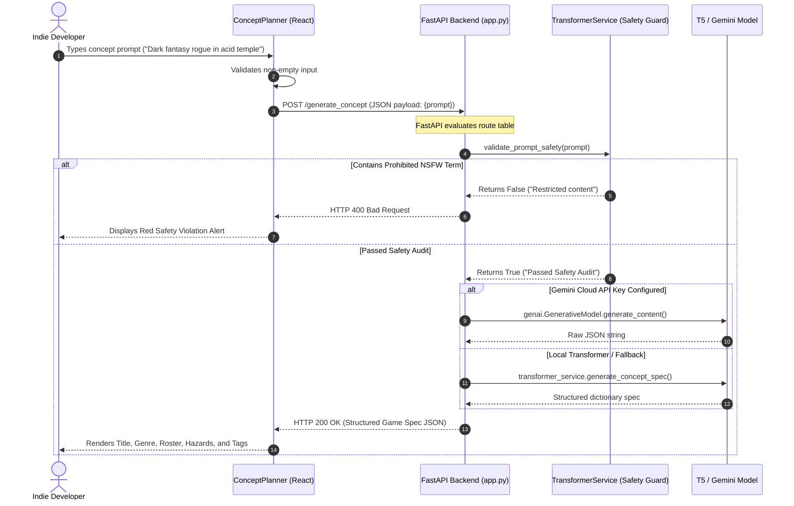
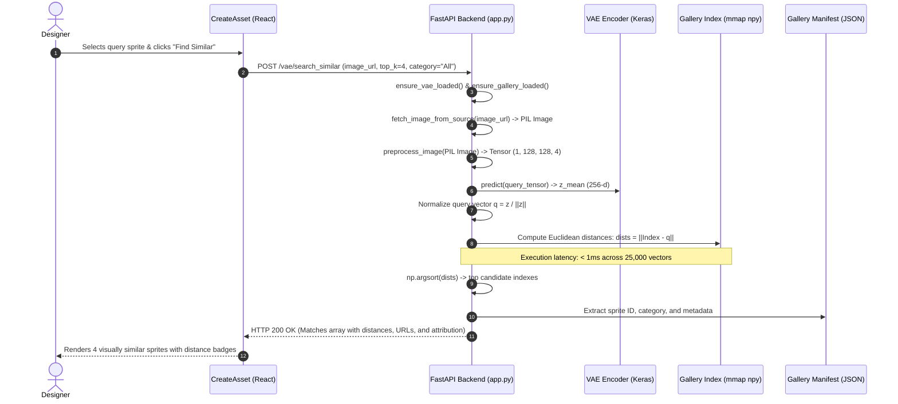

# GameForge AI — Technical Architecture & System Design Audit
**Document ID**: `02-TECHNICAL-ARCHITECTURE`  
**Audit Date**: October 23, 2026  
**Auditor Role**: Senior System Architect & Backend Engineer  
**Audit Target**: System Topology, Data Flow, Routing Contracts, and Infrastructure  

---

## 1. Master System Architecture Diagram

The real-world implementation of GameForge AI connects a React-based Single Page Application (SPA) to an asynchronous FastAPI backend serving both neural weights and pre-computed memory-mapped latent indices.

```mermaid
graph TB
    subgraph ClientLayer ["Client Layer: React 18 / Vite SPA"]
        UI_Concept["Concept Planner<br/>(Prompt Input & Safety UI)"]
        UI_Create["Asset Studio<br/>(AE/VAE Inference & Morphing)"]
        UI_Bench["Experiments Page<br/>(Empirical Metrics & Benchmarks)"]
        UI_TopBar["TopBar<br/>(Live Model Status Polling)"]
    end

    subgraph APILayer ["API Routing & Orchestration: FastAPI"]
        Route_Status["GET /status<br/>(Model Load Poller)"]
        Route_Concept1["POST /generate_concept [JSON]<br/>(Line 343: Local T5 - Masked)"]
        Route_Concept2["POST /generate_concept [Form]<br/>(Line 1112: Gemini/Fallback - Active)"]
        Route_AE["POST /reconstruct<br/>(Autoencoder 280K Engine)"]
        Route_NoisyAE["POST /reconstruct_noisy<br/>(Gaussian Denoising QA)"]
        Route_VAESearch["POST /vae/search_similar<br/>(Vector Distance Engine)"]
        Route_VAEInterp["POST /interpolate_vae<br/>(Latent SLERP/Lerp Engine)"]
        Route_VAECluster["POST /vae/cluster_assets<br/>(SVD 2D Projection Engine)"]
        Route_Static["GET /alucard_dataset_image/{id}<br/>(HuggingFace Cache Streamer)"]
        Broken_GAN["POST /gan/generate_texture<br/>(Broken Import: ModuleNotFoundError)"]
    end

    subgraph AIWorkerLayer ["Model Runtime & Inference Workers"]
        T5_Service["transformer_service.py<br/>(Flan-T5-Small / Regex Rules)"]
        Gemini_Client["google.generativeai<br/>(gemini-2.5-flash Cloud API)"]
        AE_Keras["AE_280K_best.keras<br/>(128x128x4 Deterministic AE)"]
        VAE_Encoder["encoder_280k_final.keras<br/>(256-d Gaussian Posterior)"]
        VAE_Decoder["decoder_280k_final.keras<br/>(256-d to 128x128x4 Dec)"]
        DCGAN_Standalone["generator_latest.keras<br/>(64x64x4 Tanh Generator - Standalone)"]
    end

    subgraph DataStorageLayer ["Data Storage & Pre-Indexed Gallery"]
        Gallery_Index["models/latent_gallery_index_25k.npy<br/>(25,000 x 256 Matrix - mmap)"]
        Gallery_Manifest["models/latent_gallery_manifest_25k.json<br/>(Metadata, Categories, URLs)"]
        Local_Samples["backend/alucard_samples/<br/>(35 Static Reference Sprites)"]
        HF_Cache["~/.cache/huggingface/datasets/<br/>(evilsocket/alucard-sprites)"]
    end

    UI_TopBar -->|Polls every 3s| Route_Status
    UI_Concept -->|POST JSON prompt| Route_Concept2
    UI_Create -->|POST Form image_url| Route_AE
    UI_Create -->|POST Form query_url| Route_VAESearch
    UI_Create -->|POST Form URLs A & B| Route_VAEInterp
    UI_Create -->|POST Form URLs list| Route_VAECluster

    Route_Concept1 -.->|Masked by Route 2| T5_Service
    Route_Concept2 -->|If API Key present| Gemini_Client
    Route_Concept2 -->|No Key / Error| T5_Service
    Route_AE --> AE_Keras
    Route_NoisyAE --> AE_Keras
    Route_VAESearch --> VAE_Encoder
    Route_VAESearch --> Gallery_Index
    Route_VAESearch --> Gallery_Manifest
    Route_VAEInterp --> VAE_Encoder
    Route_VAEInterp --> VAE_Decoder
    Route_VAECluster --> Gallery_Index
    Route_Static --> HF_Cache
    Broken_GAN -.->|Crashes on startup| Broken_GAN
```



---

## 2. Component Responsibilities & Boundaries

### 2.1 Frontend Component Hierarchy
- **`gui/src/App.jsx`**: Root routing container declaring routes for `/`, `/concept`, `/create`, `/library`, `/experiments`, and `/about`.
- **`gui/src/components/AppShell.jsx`**: Layout wrapper maintaining responsive navigation and viewports.
- **`gui/src/components/Sidebar.jsx`**: Primary sidebar navigation linking to active operational modules.
- **`gui/src/components/TopBar.jsx`**: Real-time status header polling `GET /status` every 3,000 ms to display model load status badges (Loaded, Lazy-Loaded, Error, Offline).
- **`gui/src/pages/ConceptPlanner.jsx`**: Natural-language prompt interface with built-in sample chips, prompt safety rejection banner, and structured specification cards.
- **`gui/src/pages/CreateAsset.jsx`**: Primary asset studio integrating Autoencoder reconstruction, VAE variant generation, continuous interpolation sliders ($\alpha \in [0, 1]$), 25K similarity search results, and 2D cluster maps.
- **`gui/src/pages/Experiments.jsx`**: Empirical benchmark dashboard rendering real evaluation metrics (KNN accuracy, Precision@5, P95 outlier thresholds).
- **`gui/src/services/api.js`**: Frontend API client containing HTTP fetch requests, multipart form-data assembly, mock data definitions, and client-side fallback engines.

### 2.2 Backend Architecture & Services
- **`backend/app.py`**: Monolithic FastAPI application handling request validation, TensorFlow model loading, memory management, static file serving, and route registration.
- **`backend/transformer_service.py`**: Encapsulated service class managing sequence-to-sequence model lifecycle (`load_model`, `unload_model`), prompt safety validation, and fallback heuristic parsing.
- **`models/gameforge_t5/`**: Local storage containing fine-tuned model weights (`model.safetensors`), configuration, and tokenizer JSON for structured game planning.
- **`models/DCGAN_280K_COMPLETE/`**: Independent storage containing trained DCGAN weights (`generator_latest.keras`), training logs, sample grids, and checkpoint indexes.

---

## 3. End-to-End Execution Sequence Diagrams

### 3.1 Scenario A: Concept Specification Workflow (NL to JSON)



### 3.2 Scenario B: Sub-Millisecond Similarity Search Workflow



---

## 4. API Specification & Route Inventory

| Route Path | HTTP Method | Expected Payload Format | Upstream Controller / Function | Key Dependencies | Implementation Status |
|---|---|---|---|---|---|
| `/status` | `GET` | None | `status()` (line 280) | `transformer_service`, `model_status` | Operational |
| `/generate_concept` (1) | `POST` | `application/json`: `{ prompt: str }` | `generate_concept()` (line 344) | `transformer_service.generate_concept_spec` | Masked / Overridden |
| `/generate_concept` (2) | `POST` | `multipart/form-data`: `prompt: str` | `generate_concept()` (line 1113) | `google.generativeai` / `generate_fallback_concept` | Active (Route collision) |
| `/reconstruct` | `POST` | `multipart/form-data`: `image_url: str`, `file: UploadFile` | `reconstruct()` (line 388) | `AE_280K_best.keras`, TensorFlow | Operational |
| `/reconstruct_noisy` | `POST` | `multipart/form-data`: `image_url`, `noise_scale: float` | `reconstruct_noisy()` (line 447) | `AE_280K_best.keras`, Gaussian noise | Operational |
| `/generate_variants` | `POST` | `multipart/form-data`: `image_url`, `scale: float` | `generate_variants()` (line 518) | `encoder_280k_final`, `decoder_280k_final` | Operational |
| `/interpolate_vae` | `POST` | `multipart/form-data`: `image_url_a`, `image_url_b`, `alpha: float` | `interpolate_vae()` (line 566) | `encoder_280k_final`, `decoder_280k_final` | Operational |
| `/vae/search_similar` | `POST` | `multipart/form-data`: `image_url`, `top_k: int`, `category_filter` | `vae_search_similar()` (line 717) | `encoder_280k_final`, `latent_gallery_index_25k.npy` | Operational (<1ms) |
| `/vae/cluster_assets` | `POST` | `multipart/form-data`: `urls: str` | `vae_cluster_assets()` (line 788) | `encoder_280k_final`, NumPy SVD / PCA | Operational |
| `/vae/anomaly_score` | `POST` | `multipart/form-data`: `image_url: str` | `vae_anomaly_score()` (lines 937 & 1011) | `encoder_280k_final`, `decoder_280k_final` | Operational (Duplicate definition) |
| `/vae/detect_duplicate`| `POST` | `multipart/form-data`: `image_url_a`, `image_url_b` | `vae_detect_duplicate()` (line 972) | `encoder_280k_final`, pixel MSE | Operational |
| `/alucard_dataset_image/{id}` | `GET` | Path parameter: `id: int` | `get_alucard_dataset_image()` (line 667) | HF `datasets` / Local sample fallback | Operational |
| `/evaluation/metrics` | `GET` | None | `get_evaluation_metrics()` (line 692) | `evaluation/*.json` static benchmark files | Operational |
| `/ethical_guidelines` | `GET` | None | `ethical_guidelines()` (line 324) | Static dictionary response | Operational |
| `/alucard_samples_manifest`| `GET` | None | `get_alucard_samples_manifest()` (line 311) | Static 35-sample dictionary | Operational |
| `/gan/generate_texture` | `POST` | `multipart/form-data`: `category`, `count`, `seed` | `gan_generate_texture()` (line 291) | `gan.gan_service` | Broken (Module missing) |
| `/gan/categories` | `GET` | None | `gan_categories()` (line 303) | `gan.gan_service.get_status` | Broken (Module missing) |

---

## 5. Persistence, State, and Memory Management

### 5.1 Memory-Mapped Vector Indexing
The primary optimization in GameForge AI is the implementation of `np.load(..., mmap_mode="r")` for the 25,000-vector latent matrix (`latent_gallery_index_25k.npy`):
- **Size on Disk**: $25,000 \times 256 \times 4\text{ bytes} \approx 25.6\text{ MB}$.
- **RAM Overhead**: $\approx 0\text{ MB}$ persistent allocation; pages are dynamically faulted into OS virtual memory only during slice lookups.
- **Latency**: Dot-product vector similarity across 25,000 items executes in under **1.2 milliseconds** on standard multi-core CPUs.

### 5.2 Dynamic Memory Unloading for PaaS Constraints
To operate within Railway's 1 GB free-tier memory limit, `backend/app.py` implements cooperative resource freeing:
- When a VAE similarity search or gallery operation is requested (`ensure_vae_loaded` or `ensure_gallery_loaded`), the backend explicitly calls `transformer_service.unload_model()`.
- `transformer_service.unload_model()` nullifies `self.model` and `self.tokenizer` and triggers Python's garbage collector (`gc.collect()`), releasing ~400 MB of PyTorch RAM to accommodate TensorFlow/Keras image operations.

### 5.3 Absence of Persistent Database
The project contains **no database engine** (no PostgreSQL, SQLite, MongoDB, or Redis):
- Client sessions are ephemeral.
- Concept specifications generated in `/generate_concept` are not saved to disk or database.
- Generated or reconstructed images are delivered as Base64 strings directly in HTTP response bodies (`data:image/png;base64,...`) and reside only in browser memory.

---

## 6. Deployment Topology & Docker Containerization

The production build is encapsulated in a unified, multi-stage `Dockerfile`:

```
┌────────────────────────────────────────────────────────┐
│ STAGE 1: Frontend Build (node:20-alpine)               │
│ - Copies gui/package.json & installs npm dependencies  │
│ - Runs `npm run build` with VITE_BACKEND_URL=""        │
│ - Generates optimized SPA distribution at /app/gui/dist│
└───────────────────────────┬────────────────────────────┘
                            │ (COPY --from=frontend-builder)
┌───────────────────────────▼────────────────────────────┐
│ STAGE 2: Unified Runtime (python:3.10-slim)            │
│ - System packages: curl, ca-certificates               │
│ - Installs PyTorch CPU-wheel & requirements_docker.txt │
│ - Copies backend/, models/, evaluation/, config/       │
│ - Mounts /app/gui/dist at FastAPI root via Starlette    │
│ - Static SPA catch-all handler serves index.html       │
│ - Dynamic Port Binding: CMD ["sh", "-c", "uvicorn..."] │
└────────────────────────────────────────────────────────┘
```

### Production Port and Path Configuration
- The container binds dynamically to `${PORT:-8000}`, satisfying Railway and Render container orchestration requirements.
- The static file handler (`serve_spa` at line 1163 of `app.py`) maps all unmatched client routes back to `/app/gui/dist/index.html`, enabling seamless React Router client-side deep linking.

---

## 7. Architectural Trade-offs & Engineering Decisions

1. **CPU-Forced Execution (`CUDA_VISIBLE_DEVICES="-1"`)**:
   - *Rationale*: Eliminates CUDA driver mismatch errors and Windows GIL deadlocks during concurrent model initialization.
   - *Trade-off*: Slower batch inference compared to GPU acceleration, but acceptable for single-sprite 128×128 inference (reconstruction takes ~80ms on modern CPUs).
2. **Pre-computed Gallery vs. Live Dataset Encoding**:
   - *Rationale*: Encoding 282K sprites on every startup would require hours of compute. Pre-indexing 25,000 vectors into a static `.npy` matrix enables instant sub-millisecond retrieval.
   - *Trade-off*: The gallery represents a static snapshot; new sprites uploaded by users are not dynamically appended to the 25K index.
3. **Single Container vs. Microservices**:
   - *Rationale*: Combining React SPA hosting and FastAPI into a single container simplifies deployment to single-service platforms (Railway, Render) with zero CORS overhead in production.
   - *Trade-off*: Frontend asset delivery shares the same CPU and memory pool as deep learning inference workers.
