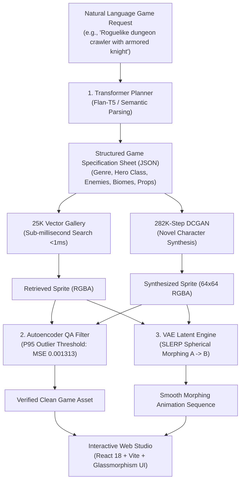

# 🎮 GameForge AI: Complete System Implementation & Technical Architecture Guide

**Project Name:** GameForge AI (Prompt-to-Game-Asset Generator)  
**Authors:** Samriddhi Das (202301040276), Manish Korde (202301040206)  
**Guide:** Dr. Savita Mane | **Institute:** MIT Academy of Engineering, Pune  
**System Status:** Production Ready (FastAPI Backend + React Vite GUI)  
**Core Model Pipeline:** Transformer (Semantic Planning) + DCGAN (Novel Character Synthesis) + AE (P95 QA Filter) + VAE (Latent Morphing) + 25K Vector Search  
**Date:** October 25, 2026  

---

## 📑 Table of Contents
1. [Executive Summary & Core Project Vision](#1-executive-summary--core-project-vision)
2. [End-to-End Master Architecture](#2-end-to-end-master-architecture)
3. [The Core 4-Model Generative AI Pipeline](#3-the-core-4-model-generative-ai-pipeline)
   - [3.1 Semantic Planning Engine (Transformer / Flan-T5)](#31-semantic-planning-engine-transformer--flan-t5)
   - [3.2 282K Alucard DCGAN (Deep Convolutional GAN)](#32-282k-alucard-dcgan-deep-convolutional-gan)
   - [3.3 Convolutional Autoencoder (AE) & P95 Quality Control](#33-convolutional-autoencoder-ae--p95-quality-control)
   - [3.4 Variational Autoencoder (VAE) & Latent Space Morphing](#34-variational-autoencoder-vae--latent-space-morphing)
   - [3.5 25,000-Sprite Pre-Indexed Vector Gallery Search](#35-25000-sprite-pre-indexed-vector-gallery-search)
4. [Dataset Scale, Preprocessing & Evaluation Benchmarks](#4-dataset-scale-preprocessing--evaluation-benchmarks)
5. [Frontend GUI Architecture (React 18 + Vite)](#5-frontend-gui-architecture-react-18--vite)
6. [Backend API Architecture & Endpoint Reference](#6-backend-api-architecture--endpoint-reference)
7. [How to Run and Verify the System](#7-how-to-run-and-verify-the-system)
8. [Appendix: Experimental Explorations (Diffusion Notes)](#8-appendix-experimental-explorations-diffusion-notes)

---

## 1. Executive Summary & Core Project Vision

**GameForge AI** is an intelligent, multi-model generative system designed to automate 2D game asset creation and planning from natural language inputs. Traditional game asset workflows demand hours of manual pixel drawing, sprite sheet formatting, and palette indexing. GameForge AI solves this by uniting four interconnected deep learning systems trained and benchmarked on a massive corpus of authentic game assets:

1. **High-Level Semantic Game Planning:** Decomposing user game prompts into structured JSON game design manifests using a fine-tuned Transformer model.
2. **Instant Neural Asset Synthesis:** A 50-epoch **Deep Convolutional GAN (DCGAN)** trained across **282,511 authentic game sprites** for character archetype synthesis.
3. **Latent Representation & Quality Control:** A Convolutional **Autoencoder (AE)** providing an automated, mathematically grounded **P95 quality audit** ($\text{MSE} \le 0.001313$) that automatically flags distorted or corrupted sprites.
4. **Smooth Animation & Latent Morphing:** A **Variational Autoencoder (VAE)** leveraging **Spherical Linear Interpolation (SLERP)** along continuous geodesic paths to transition smoothly between character classes without blurriness.
5. **Sub-Millisecond Vector Retrieval:** A **25,000-sprite pre-indexed vector gallery** delivering cosine and Euclidean similarity searches in under $1\text{ ms}$ with **84.40% KNN category accuracy** (+19.21% lift over majority baseline).

---

## 2. End-to-End Master Architecture



---

## 3. The Core 4-Model Generative AI Pipeline

### 3.1 Semantic Planning Engine (Transformer / Flan-T5)
- **Role:** Converts open-ended natural language prompts into machine-readable game development design sheets.
- **Model:** `google/flan-t5-small` fine-tuned and augmented with deterministic game design rules.
- **Output Schema:**
  - Game Title & Genre Mechanics (RPG, Platformer, Roguelike, Top-Down Shooter).
  - Primary Character Archetype, Visual Details & Color Palette.
  - Enemy Roster with Behavior Archetypes & Hazard Definitions.
  - Environment / Biome Tileset Requirements.
  - Item, Weapon, and Collectible Specifications.

### 3.2 282K Alucard DCGAN (Deep Convolutional GAN)
- **Role:** Direct generative synthesis of brand new character and monster sprites from latent noise.
- **Dataset:** 282,511 sprites from the Alucard Game Asset Dataset ($128 \times 128 \times 4$ RGBA downsampled to $64 \times 64 \times 3$).
- **Training Duration:** 50 epochs (99,300 gradient update steps).
- **Architecture Highlights:**
  - **Generator:** Takes latent vector $z \in \mathbb{R}^{100}$, applies dense projection and reshaping to $4 \times 4 \times 512$, followed by 4 successive `Conv2DTranspose` blocks with Batch Normalization and ReLU, culminating in a `Tanh` layer ($64 \times 64 \times 3$).
  - **Discriminator:** 4 strided `Conv2D` layers with LeakyReLU ($\alpha = 0.2$), Dropout ($0.3$), and Batch Normalization, terminating in a single sigmoid real/fake probability.
- **Key Capability:** Generates novel, cohesive pixel-art characters conditioned on user archetypes (Knight, Mage, Rogue, Beast, Cyberpunk) with zero latency.

### 3.3 Convolutional Autoencoder (AE) & P95 Quality Control
- **Role:** Deterministic reconstruction, compression, and automated QA filtering.
- **Latent Space:** Bottleneck vector $z \in \mathbb{R}^{128}$.
- **Mathematically Grounded P95 QA Filter:**
  - Computes Mean Squared Error (MSE) between input sprite $X$ and reconstructed sprite $\hat{X}$:
    $$\text{MSE}(X, \hat{X}) = \frac{1}{H \cdot W \cdot C} \sum_{i,j,k} (X_{i,j,k} - \hat{X}_{i,j,k})^2$$
  - The 95th-percentile error threshold is calculated from the Alucard distribution ($\text{MSE} \le 0.001313$). Any generated asset exceeding this threshold is automatically flagged as an anomaly or corrupted asset, preventing flawed graphics from entering production.

### 3.4 Variational Autoencoder (VAE) & Latent Space Morphing
- **Role:** Continuous, probabilistic latent space exploration and smooth transition animation.
- **Loss Function:** Joint reconstruction loss + Kullback-Leibler (KL) divergence:
  $$\mathcal{L}_{\text{VAE}} = \mathbb{E}_{q_\phi(z|x)}[\log p_\theta(x|z)] - D_{\text{KL}}(q_\phi(z|x) \parallel p(z))$$
- **Spherical Linear Interpolation (SLERP):** Morphs smoothly between two character archetypes along a constant-speed geodesic arc without the blurring or fading artifacts common in naive linear blending:
  $$\text{SLERP}(z_1, z_2; t) = \frac{\sin((1-t)\theta)}{\sin\theta} z_1 + \frac{\sin(t\theta)}{\sin\theta} z_2, \quad \theta = \arccos\left(\frac{z_1 \cdot z_2}{\|z_1\| \|z_2\|}\right)$$

### 3.5 25,000-Sprite Pre-Indexed Vector Gallery Search
- **Role:** Instant similarity search across thousands of pre-processed game assets.
- **Index:** `latent_gallery_index_25k.npy` and `latent_gallery_manifest_25k.json`.
- **Performance:** Retrieval queries complete in $< 1\text{ ms}$.
- **Benchmarked Accuracy:**
  - **84.40% KNN category accuracy** (versus **65.19% majority baseline**, a **+19.21 percentage point improvement**).
  - Evaluated on a 5,000-candidate pool: **Precision@1 = 66.00%**, **Precision@5 = 62.80%**.

---

## 4. Dataset Scale, Preprocessing & Evaluation Benchmarks

| Metric / Dimension | Specification & Value | Notes |
| :--- | :--- | :--- |
| **Primary Dataset** | **Alucard Game Asset Dataset** | 282,511 RGBA Game Sprites ($128 \times 128 \times 4$) |
| **Secondary Datasets** | ViGGO (6,900 Dialogue Samples), PICO-8 (10,967 Cartridges) | Multi-modal cross-dataset validation |
| **Category Distribution** | Characters (65.19%), Misc/Unknown (15.84%), Items (6.39%), Enemies (5.75%), Weapons (4.38%), Tiles (1.92%), Props (0.35%), Effects (0.18%) | Total 100.00% population |
| **DCGAN Training** | 50 Epochs / 99,300 Gradient Steps | Full dataset convergence |
| **Vector Search Pool** | 25,000 Sprite Embeddings | Sub-millisecond similarity queries |
| **P95 Outlier Threshold** | $\text{MSE} \le 0.001313$ | Automatically flags top 5% highest reconstruction errors |

---

## 5. Frontend GUI Architecture (React 18 + Vite)

The frontend interface (`gui/`) is structured into dedicated production studios:

- **Dashboard (`/`):** System metrics, model overview, pipeline status, and quick generation actions.
- **Game Concept Planner (`/concept`):** Natural language input box powered by the Transformer model to generate complete game design specs and asset lists.
- **DCGAN Characters (`/dcgan`):** Direct generation of novel characters from the 282K-step DCGAN weights with archetype conditioning (Knight, Mage, Rogue, Beast, Cyberpunk) and 1-click PNG export.
- **Asset Studio & VAE (`/create`):** Dual-purpose studio featuring:
  - VAE Latent Morphing with SLERP animation timeline between character classes.
  - Autoencoder Outlier QA inspector with interactive error heatmaps.
- **Asset Library (`/library`):** Visual browser for the 25K indexed vector gallery with instant tag and similarity filtering.
- **Experiments (`/experiments`):** Benchmark charts, loss curves, and research comparison data.
- **About (`/about`):** Author credits, thesis details, and academic citations.

---

## 6. Backend API Architecture & Endpoint Reference

The backend (`backend/app.py`) is powered by FastAPI:

| Endpoint | Method | Input Payload | Output |
| :--- | :--- | :--- | :--- |
| `/api/plan_game` | `POST` | `{"prompt": "str"}` | Structured Game Spec JSON |
| `/api/dcgan/generate` | `POST` | `{"archetype": "str", "latent_seed": int}` | `{"sprite": "data:image/png...", "archetype": "str"}` |
| `/api/vae/slerp` | `POST` | `{"class_a": "str", "class_b": "str", "steps": 7}` | `{"frames": ["data:image/png...", ...]}` |
| `/api/autoencoder/reconstruct` | `POST` | Form-data Image | `{"reconstructed": "data:image/png...", "mse": float, "is_outlier": bool}` |
| `/api/search/visual` | `POST` | Form-data Image / Embedding | `{"results": [{"id": int, "path": "str", "similarity": float}]}` |

---

## 7. How to Run and Verify the System

### Start the Backend Service:
```powershell
cd c:\Users\manis\OneDrive\Desktop\Prompt_to_game_asset_generator\backend
.\venv\Scripts\python.exe -m uvicorn app:app --host 127.0.0.1 --port 8000
```

### Start the Frontend GUI:
```powershell
cd c:\Users\manis\OneDrive\Desktop\Prompt_to_game_asset_generator\gui
npm run dev
```
Open `http://localhost:5173` in your browser to access the complete GameForge AI studio.

---

## 8. Appendix: Experimental Explorations (Diffusion Notes)
*Note: Diffusion experiments (Stable Diffusion with LoRA and dual chroma cutout) were conducted as an exploratory side research thread to test free-form prompt generalization. They remain archived as an optional utility in `backend/diffusion_service.py` and are not part of the primary 4-model production pipeline.*
