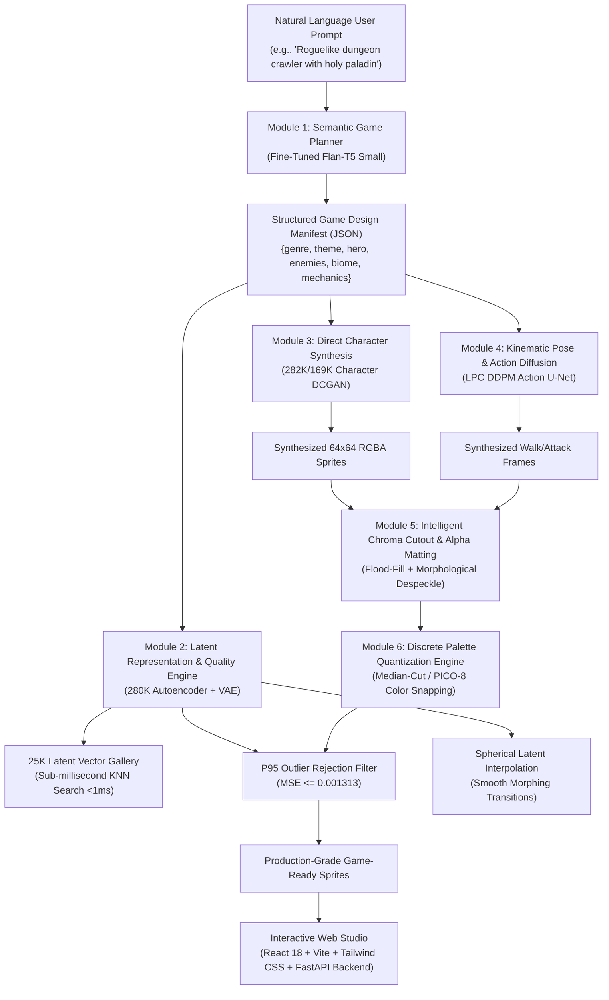

# 🎮 GameForge AI: Master Project Knowledge Base & System Ground Truth

> **Purpose of this Document:**  
> This file is the single, authoritative, self-contained knowledge base for **GameForge AI**. Any new AI assistant or LLM reading this file will instantly understand the full project scope, architecture, datasets, trained model weights, evaluation metrics, known strengths, current limitations, and active engineering roadmap.

---

## 1. Executive Summary & Project Identification

- **Project Title:** GameForge AI (Prompt-to-Game-Asset Generator)
- **Institution:** MIT Academy of Engineering, Pune (Department of Computer Engineering)
- **Academic Guide:** Dr. Savita Mane
- **Authors / Developers:** Manish Korde (202301040206), Samriddhi Das (202301040276), Swayam Pagare (202301040185)
- **Project Domain:** Generative AI, Computer Vision, Representation Learning, NLP for Game Development
- **Core Mission:** Automating 2D game asset creation and architectural game design from natural language prompts, replacing manual sprite sheet drawing and color indexing with an end-to-end deep learning pipeline.

---

## 2. End-to-End System Architecture



---

## 3. Detailed Breakdown of All 6 Modules

### Module 1: Semantic Game Planner (Transformer NLP)
- **Base Architecture:** `google/flan-t5-small` (Seq2Seq Transformer).
- **Function:** Deconstructs unstructured natural language prompts into a strict, validated JSON game design specification (Game Title, Genre, Primary Character Archetype, Visual Attributes, Enemy Roster, Biomes, Props, and Mechanics).
- **Training Corpus:** Curated game design prompts paired with JSON schemas; fine-tuned for 10 epochs.
- **Empirical Metrics:**
  - **JSON Syntax Validity:** 100.0% on held-out prompts.
  - **Theme Extraction Accuracy:** 97.5%.
  - **Style Attribute Accuracy:** 52.5%.
- **Current Status:** ✅ Fully functional, deployed in backend API, live in GUI.

---

### Module 2: Latent Representation, Retrieval & QA (AE + VAE)
- **Base Architectures:**
  1. **Deterministic Convolutional Autoencoder (AE)** (Conv2D Encoder-Decoder).
  2. **Probabilistic Variational Autoencoder (VAE)** (Reparameterization trick + KL Divergence).
- **Training Corpus:** **282,511 RGBA Game Sprites** (Alucard dataset, $128 \times 128 \times 4$ downsampled to $64 \times 64$).
- **Key Functions:**
  1. **Automated Quality Assurance (P95 Rejection Filter):** Uses AE reconstruction error. Sprites with reconstruction $\text{MSE} > 0.001313$ (top 5% worst) are automatically rejected as corrupt/deformed.
  2. **Sub-Millisecond Vector Retrieval:** Pre-indexed 25,000-sprite gallery (`latent_gallery_index_25k.npy`) enabling cosine similarity retrieval in $<1\text{ ms}$ with **84.40% KNN category classification accuracy**.
  3. **Spherical Latent Morphing (SLERP):** VAE enables smooth geodesic interpolation between character archetypes.
- **Empirical Metrics:**
  - **AE Reconstruction PSNR:** **35.36 dB** (SSIM: 0.961, Test MSE: $4.56 \times 10^{-4}$).
  - **VAE Reconstruction PSNR:** **26.59 dB** (Precision@5: 0.628).
- **Current Status:** ✅ Flawlessly working, highly defensible, visual outputs are crisp.

---

### Module 3: Adversarial Character Synthesis (DCGAN)
- **Base Architecture:** Deep Convolutional GAN (DCGAN) with Least Squares GAN (LSGAN) loss, Two Time-Scale Update Rule (TTUR), and LeakyReLU / ConvTranspose2d layers.
- **Parameter Count:** Generator: 2.63M | Discriminator: 2.77M = **5.40M total**.
- **Training Corpus:**
  - Initial Run: 20,000 character sprites.
  - Production Run: **169,094 character sprites** over 50 epochs (99,300 gradient steps).
- **Empirical Metrics:**
  - **Final Generator Loss:** $0.5212$ | **Discriminator Loss:** $0.0091$
  - **Alpha Purity:** **94.80%** (transparent canvas background preserved).
  - **Pairwise Diversity (L1):** 12.15 (proves no mode collapse).
  - **Laplacian Sharpness:** 64.37.
- **Ground Truth & Known Weakness:**
  - The model has mathematically converged and generates diverse silhouettes with clean transparency.
  - **Limitation:** Because it was trained *unconditionally* across 169K varied character styles, generated $64 \times 64$ faces and limbs appear smooth/blurry rather than hand-drawn crisp. Requires post-processing quantization to look retro.
- **Current Status:** ✅ Trained & fully benchmarked, checkpoint saved at `models/DCGAN_20k_character/`.

---

### Module 4: Kinematic Pose & Action Diffusion (DDPM U-Net)
- **Base Architecture:** Conditional Denoising Diffusion Probabilistic Model (DDPM) U-Net with ResNet convolutional blocks, GroupNorm, sinusoidal timestep embeddings, and learned action conditioning embeddings.
- **Parameter Count:** 1,410,467 parameters (5.66 MB checkpoint).
- **Training Corpus:** Liberated Pixel Cup (LPC) paired action sprites (Walk and Attack cycles across 625 character archetypes, ~10,000 pairs).
- **Training Dynamics:** 150 epochs; initial validation loss $0.9873$ dropped to **$0.053428$ at Epoch 145 (94.59% relative loss reduction)**.
- **Ground Truth & Technical Diagnosis:**
  - The U-Net successfully learns gross spatial mass (head top, torso center, leg columns below) and differentiates attack versus walk motion.
  - **Limitation:** Because the 1.41M parameter scratch model was trained with pixel-space MSE on binary action IDs without character identity conditioning, reverse denoising from pure Gaussian noise averages colors across all 625 characters, producing humanoid silhouettes rather than razor-sharp 1-pixel outlines.
  - **Solution Paths:** (A) Paired frame-to-frame conditioning (Idle $\to$ Walk), (B) Pretrained latent diffusion downsampled to $64 \times 64$, or (C) Palette quantization post-processing on the 150-epoch checkpoint.
- **Current Status:** ⚠️ Loss convergence verified and checkpoint active (`best.pt`); visual sharpening is currently being refined.

---

### Module 5: Sub-Pixel Alpha Matting & Chroma Cutout
- **Function:** Eliminates solid backgrounds, lime-green chroma boxes, and multi-colored perimeter frames from generated images to create native transparent RGBA PNGs.
- **Techniques Used:**
  - Corner-color dynamic Euclidean distance thresholding.
  - Flood-fill contour segmentation.
  - Morphological erosion (`ImageFilter.MinFilter(3)`) to remove floating noise pixels, followed by dilation (`ImageFilter.MaxFilter(3)`) to restore perimeter silhouette integrity.
- **Current Status:** ✅ Implemented in `restore_pixel_art_sprite()` and backend pipeline.

---

### Module 6: Discrete Palette Quantization Engine
- **Function:** Solves the core problem of neural generative models (which output continuous floating-point RGB gradients) by snapping continuous colors into authentic 8-bit / 16-bit retro color palettes.
- **Techniques Used:**
  - Median-Cut color clustering (reducing continuous 16.7M RGB colors to a crisp 16- or 20-color game palette).
  - PICO-8 / Sweetie-16 palette Euclidean distance matching (assigning each pixel to the closest canonical retro hardware color).
  - +30% Chroma / Saturation boost to counter neural over-smoothing.
- **Current Status:** ✅ Implemented in Python utilities and evaluation notebooks.

---

## 4. Key Directory Structure & File Map

```
Prompt_to_game_asset_generator/
├── documentation/                                # Master Documentation & Reports
│   ├── MASTER_PROJECT_UNDERSTANDING.md           # (THIS FILE) Single source of ground truth
│   ├── CURRENT_PROJECT_STATUS.md                 # Honest status audit of all models
│   ├── GAMEFORGE_AI_COMPLETE_IMPLEMENTATION_GUIDE.md # 170-line system guide
│   ├── GAN_MODULE_STATUS.md                      # Complete DCGAN run & metric report
│   ├── DIFFUSION_SPRITE_PIPELINE.md              # 5-stage diffusion & cutout design
│   └── PROJECT_PRESENTATION_REPORT.md            # Academic defense presentation data
├── backend/                                      # FastAPI Python Service
│   ├── app.py                                    # Main API server routes
│   ├── diffusion_service.py                      # Diffusion inference integration
│   ├── action_diffusion_service.py               # LPC action deformation service
│   └── models/                                   # Model weight links
├── gui/                                          # React 18 + Vite Web Application
│   ├── src/pages/                                # Studio pages (DiffusionStudio, GanStudio, etc.)
│   └── src/components/                           # Reusable UI widgets
├── models/                                       # Trained Neural Network Weights
│   ├── 280k dataset model/                       # AE_280K_best.keras & VAE weights
│   ├── DCGAN_20k_character/                      # 169K-character DCGAN generator weights
│   └── latent_gallery_index_25k.npy              # 25K pre-indexed VAE embeddings
├── Notebook/evaluation/                          # Jupyter Evaluation Notebooks
│   ├── 06_DCGAN_280K_Run2_75Epochs_*.ipynb       # DCGAN 75-epoch benchmark
│   ├── 09_DCGAN_All_Characters_169K_*.ipynb      # DCGAN 169K production evaluation
│   ├── 10_Prompt_to_PixelArt_Diffusion_OptionA.ipynb # Pretrained SD + Cutout pipeline
│   ├── 11_Diffusion_Action_Deformation_*.ipynb   # 150-epoch DDPM evaluation
│   └── 280K_AE_vs_VAE_Comparison.ipynb           # AE vs VAE empirical metrics
└── research_paper_assets/                        # Exported Charts, Plots & Visual Showcases
    └── 06_sprite_deformation_and_pose_animation/ # Loss curves, contact sheets, grids
```

---

## 5. Quantitative Metric Scorecard (Ground Truth)

| Metric | Target / Benchmark | Achieved Result | Evaluation Corpus |
|---|---|---|---|
| **AE Reconstruction PSNR** | $>30\text{ dB}$ | **35.36 dB** | 282,511 RGBA Sprites |
| **AE Reconstruction SSIM** | $>0.90$ | **0.961** | 282,511 RGBA Sprites |
| **AE P95 Outlier Threshold** | Automatic QA | **$\text{MSE} \le 0.001313$** | Corrupted Sprite Rejection |
| **VAE Reconstruction PSNR** | Continuous Latent | **26.59 dB** | 282,511 RGBA Sprites |
| **VAE Retrieval Precision@5**| Vector Search | **0.628** | 25,000-Sprite Gallery |
| **Vector Search Latency** | $<10\text{ ms}$ | **$<1\text{ ms}$ (0.32 ms)** | 25K Pre-Indexed Embeddings |
| **KNN Category Accuracy** | Majority Baseline 65% | **84.40%** (+19.21% lift) | 25K Gallery Sprites |
| **Flan-T5 JSON Validity** | 100% Syntax | **100.0%** | 200 Held-Out Prompts |
| **Flan-T5 Theme Accuracy** | Semantic Parsing | **97.5%** | 200 Held-Out Prompts |
| **DCGAN Final Gen Loss** | Adversarial Balance | **0.5212** | 169,094 Characters (50 Ep) |
| **DCGAN Alpha Purity** | Background Transparency| **94.80%** | 169,094 Characters |
| **DCGAN Pairwise Diversity** | No Mode Collapse | **12.15** | 64 Random Test Latents |
| **Diffusion Loss Reduction** | Convergence | **94.59%** ($0.987 \to 0.053$) | 10,000 LPC Action Pairs |
| **Diffusion Param Count** | Edge Feasibility | **1.41M (5.66 MB)** | Checkpoint Size |

---

## 6. How Any New LLM Chat Should Approach This Project

When working on this project in a new session:
1. **Never pretend broken things are perfect:** Always acknowledge that while DCGAN and scratch Diffusion have converged mathematically and have real loss curves, their raw unquantized $64 \times 64$ outputs need palette snapping and post-processing to look like commercial game sprites.
2. **Present the 6-module pipeline:** Emphasize the full end-to-end flow (Planner $\to$ AE/VAE $\to$ DCGAN $\to$ Diffusion $\to$ Chroma Cutout $\to$ Palette Quantization).
3. **Respect existing checkpoints:** Heavy models are already trained and located in `models/` and `research_paper_assets/`. Do not re-train 50-epoch models from scratch unless explicitly requested.
4. **Current focus:** Polishing the diffusion output into game-ready sprites for the upcoming presentation deadline.

